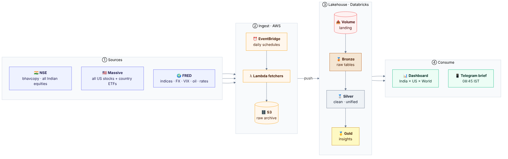

# stocks-lakehouse

A multi-market stock lakehouse on **AWS + Databricks**, built on a **medallion architecture**
(bronze → silver → gold), fully deployed with **Terraform** and **GitHub Actions**.

It collects Indian, US and global market data every day, turns it into cross-market insights, shows them on
a dashboard, and sends a **pre-market brief to Telegram** before the Indian market opens.



**Diagrams with explanations:** [docs/ARCHITECTURE_DIAGRAMS.md](docs/ARCHITECTURE_DIAGRAMS.md)
covers the base view above, the full [architecture](docs/ARCHITECTURE_DIAGRAMS.md#2-architecture),
[data lineage](docs/ARCHITECTURE_DIAGRAMS.md#3-data-lineage) (all 17 tables) and the
[CI/CD flow](docs/ARCHITECTURE_DIAGRAMS.md#4-cicd-flow).

## What you get

| Output | Where | When |
|---|---|---|
| Daily raw data (NSE, US, global) | S3 `landing/` + Databricks volume | Every trading day |
| 17 bronze/silver/gold tables | Unity Catalog `stocks.*` | Refreshed when new files land |
| Dashboard "Stocks lakehouse: India x US" | Databricks workspace | Always current |
| Pre-market brief | Your Telegram | 08:45 IST, Mon–Fri |

Gold insights include: how India opens after big US moves, which global markets line up with India's open,
market breadth, unusual volume, Indian ADR premium vs USD/INR, and a global markets snapshot.

## Daily timeline (IST)

| Time | What happens |
|---|---|
| 04:30 Tue–Sat | Massive: previous US session (all US stocks) |
| 06:00 Tue–Sat | FRED: global indices, FX, VIX, oil, rates (rolling 21-day window) |
| after each file | Databricks job refreshes the pipeline (file-arrival trigger) |
| 08:45 Mon–Fri | Pre-market brief to Telegram |
| 19:30 Mon–Fri | NSE: today's equities bhavcopy |

## Repository layout

```
fetchers/          Lambda code: nse, massive, fred, sync, premarket (+ shared helpers). Python stdlib + boto3 only.
pipeline/          Lakeflow pipeline in Python (bronze.py, silver.py, gold.py), SQL equivalents in comments
infra/
  bootstrap/       S3 bucket for Terraform state (run once, locally)
  modules/         secure_bucket: private, encrypted, versioned, HTTPS-only S3
  aws/             Landing bucket, Lambdas, schedules, IAM, SSM parameters, CI users
  databricks/      Catalog, schemas, volume, token, pipeline, job, dashboard
tests/             Unit tests (no cloud access needed)
scripts/           check_pipeline.py (pipeline wiring check, used by CI), render_diagrams (re-render docs/diagrams)
.github/           CI (tests, fmt, validate) and CD (plan on PR, apply on merge)
docs/              Full documentation (below); docs/diagrams/ holds the diagram sources and images
```

## Documentation

| Doc | Read it when |
|---|---|
| [docs/ARCHITECTURE_DIAGRAMS.md](docs/ARCHITECTURE_DIAGRAMS.md) | You want the picture: base, architecture, lineage and CI/CD diagrams, each explained |
| [docs/ARCHITECTURE.md](docs/ARCHITECTURE.md) | You want to understand how it fits together and why it's built this way |
| [docs/SETUP.md](docs/SETUP.md) | You're building it from scratch: every step, in order, with Windows commands |
| [docs/OPERATIONS.md](docs/OPERATIONS.md) | Day to day: making changes, backfills, monitoring, rotating secrets |
| [docs/DATA_MODEL.md](docs/DATA_MODEL.md) | You're querying the tables: every table, its grain and columns |
| [docs/TROUBLESHOOTING.md](docs/TROUBLESHOOTING.md) | Something failed: every error we hit while building this, and the fix |

## How changes ship

```
edit on dev  ──push──▶  CI: tests, pipeline wiring, terraform fmt + validate
              ──PR to main──▶  terraform plan (aws, databricks) posted as PR comments
              ──merge──▶  terraform apply (aws, then databricks)
```

`main` only changes through pull requests. Nobody runs `terraform apply` locally except for first-time setup
or emergencies.

## Data sources and limits

| Source | Coverage | History available | Cost |
|---|---|---|---|
| NSE UDiFF bhavcopy | All NSE cash-market securities | From 8 Jul 2024 (format change) | Free |
| Massive grouped daily | All US stocks and ETFs | Rolling 2 years on the free Basic plan | Free (API key) |
| FRED | 14 series: S&P 500, Dow, Nasdaq, Nikkei 225, VIX, USD/INR, USD/JPY, EUR/USD, GBP/USD, USD/CNY, dollar index, Brent, WTI, US 10Y | Decades | Free (API key) |

Country ETFs (Japan, Germany, UK, Eurozone, Europe, China, Hong Kong, Korea, Taiwan, Brazil, EM, India)
come from the Massive data, giving daily equity coverage for markets FRED doesn't carry.

*Historical tendencies only. Not investment advice.*
