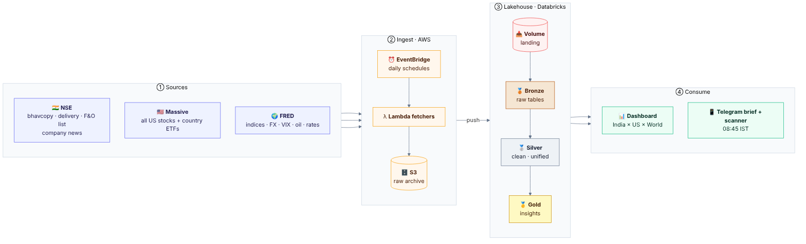

# stocks-lakehouse

A multi-market stock lakehouse on **AWS + Databricks**, built on a **medallion architecture**
(bronze → silver → gold), fully deployed with **Terraform** and **GitHub Actions**.

It collects Indian, US and global market data every day, turns it into cross-market insights, shows them on
a dashboard, and sends a **pre-market brief to Telegram** before the Indian market opens.



**Diagrams with explanations:** [docs/ARCHITECTURE_DIAGRAMS.md](docs/ARCHITECTURE_DIAGRAMS.md)
covers the base view above, the full [architecture](docs/ARCHITECTURE_DIAGRAMS.md#2-architecture),
[data lineage](docs/ARCHITECTURE_DIAGRAMS.md#3-data-lineage) (every pipeline table) and the
[CI/CD flow](docs/ARCHITECTURE_DIAGRAMS.md#4-cicd-flow), and the
[platform shared with paper-trader](docs/ARCHITECTURE_DIAGRAMS.md#5-platform-with-paper-trader).

## What you get

| Output | Where | When |
|---|---|---|
| Daily raw data (NSE, US, global) | S3 `landing/` + Databricks volume | Every trading day |
| Bronze, silver and gold tables | Unity Catalog `stocks.*` | Refreshed when new files land |
| Dashboard "Stocks lakehouse: India x US" (pages Desk, Intraday, Swing, Long term (each with a real / shadow Show filter), Your calls, Global markets) | Databricks workspace | Always current; summaries rebuilt after every refresh |
| Pre-market brief | Your Telegram | 08:45 IST, Mon–Fri |
| Paper-trading analysis ([paper-trader](https://github.com/bumblebee26/paper-trader)) | `stocks.gold.trad*` tables + dashboard pages "Desk" and "Intraday" (tiles: net P&L, win rate, profit factor, expectancy, win/loss ratio; real vs shadow lines, daily P&L, by setup and hour) | After the 15:45 IST export |
| Dummy portfolio and holdings | `stocks.gold.portfolio_daily`, `stocks.gold.holdings_latest` + dashboard page "Desk" (value, return vs NIFTYBEES, today's decisions, track record by setup, holdings) | After the 15:45 IST export |
| Your own trades from Telegram ([paper-trader](https://github.com/bumblebee26/paper-trader)) | `stocks.gold.custom_trades` (intraday and pool trades you placed, marked custom) | After each export |
| Technical scanner (Nifty 200) | `stocks.gold.technical_screen` (today's strict picks, near-misses, levels), `stocks.gold.technical_indicators` (daily history), `stocks.gold.signal_performance` (how each signal did 5/10/20 days later vs NIFTYBEES), `stocks.gold.data_freshness` | After each NSE day |
| News radar and shadow pools ([paper-trader](https://github.com/bumblebee26/paper-trader)) | `stocks.gold.intraday_universe` (Nifty 200 names the trader may trade, flagged on news/moves), `stocks.gold.swing_signals` (news breakouts), `stocks.gold.momentum_ranks` (swing and long-term momentum ranks for the momentum shadow pools), `stocks.gold.shadow_pools_daily` (every shadow pool vs NIFTYBEES) + dashboard pages "Swing" and "Long term" | After each NSE day / daily |
| Tests on paper and your ratings ([paper-trader](https://github.com/bumblebee26/paper-trader)) | `stocks.gold.shadow_rules_trades`, `shadow_rules_summary` (exit rules and shadow models on your real trades), `orb_test`, `model_backtest`, `rating_review` (your 👍/👎 vs what happened) + dashboard pages "Intraday" and "Your calls" | After each export |
| Company quality and long-term picks | `stocks.gold.company_fundamentals`, `stocks.gold.longterm_candidates` (this week's 10 picks from the Nifty 200, max 2 per industry, with target weights and reasons) + dashboard page "Long term" | Saturdays |

The paper-trading ledger was reset on 17 Nov 2026: the money tables and pages (portfolio, shadow pools, daily
P&L, results per setup and hour, decisions, custom trades) start on 18 Nov (`ledger_start`); the track record,
ratings and rule tests keep all history.

Gold insights include: how India opens after big US moves, which global markets line up with India's open,
market breadth, unusual volume, Indian ADR premium vs USD/INR, and a global markets snapshot.

## Daily timeline (IST)

| Time | What happens |
|---|---|
| 11:00 Tue–Sat | Massive: previous US session (all US stocks; the free plan releases it ~10:30 IST), catching up missed days. History only |
| 08:00 Mon | NSE F&O stock list |
| 06:00 Tue–Sat | FRED: global indices, FX, VIX, oil, rates (rolling 21-day window) |
| ~19:35 Mon–Fri | Databricks job `stocks-market-close` (when the NSE file lands): pipelines `stocks-market` then `stocks-research`, then the dashboard summaries |
| ~15:50, ~23:35 Mon–Fri | Databricks job `stocks-trading` (when paper-trader's export lands): pipeline `stocks-trading`, then the dashboard summaries |
| 08:00, 12:00 Sat | Databricks job `stocks-market-weekend`: market and research (fundamentals, Nifty 200 list, Friday's US file) |
| every minute 09:00–15:59, every 30 min otherwise (08:00–19:30) Mon–Fri | Company news: NSE (announcements, results, board meetings, corporate actions) every run; Business Standard markets, RBI and SEBI press releases at most every 4–5 minutes; BSE announcements built but off (`bse_news_enabled`) |
| 08:45 Mon–Fri | Pre-market brief and the technical scanner to Telegram (India first; US figures live from Yahoo) |
| 15:45 Mon–Fri | paper-trader pushes the day's trade journal to `landing/trades/` and a portfolio snapshot to `landing/portfolio/` |
| 19:30 Mon–Fri | NSE: today's equities bhavcopy and delivery file |
| 23:30 Mon–Fri | paper-trader re-sends the last 4 days' journals, so evening 👍/👎 ratings (`gold.rating_review`) and the 16:10 shadow-model results (`gold.model_backtest`, `gold.shadow_rules_*`) arrive overnight |
| 07:15 Sat | paper-trader pushes company financials to `landing/fundamentals/` and NSE's Nifty 200 list to `landing/index_members/` |

## Repository layout

```
fetchers/          Lambda code: nse (+ delivery), nse_fo, massive, fred, news, sync, premarket, yahoo (+ shared helpers). Python stdlib + boto3 only.
pipeline/          Lakeflow pipelines in Python, SQL equivalents in comments:
  market/          bronze.py, silver.py, gold.py: market data in, cleaned, light summaries (33 tables)
  research/        gold.py: technical scanner, momentum ranks, signal record, data freshness (5 tables, pandas)
  trading/         bronze.py, silver.py, gold.py: paper-trader journal, portfolio, shadows (23 tables)
sql/               dashboard_summary.sql: "In plain words" page summaries, run by each job after its pipelines
infra/
  bootstrap/       S3 bucket for Terraform state (run once, locally)
  modules/         secure_bucket: private, encrypted, versioned, HTTPS-only S3
  aws/             Landing bucket, Lambdas, schedules, IAM, SSM parameters, CI users
  databricks/      Catalog, schemas, volumes, token, three pipelines, three jobs, dashboard
tests/             Unit tests (no cloud access needed)
scripts/           check_pipeline.py (pipeline wiring check, used by CI), check_sql.py (dashboard and summary SQL
                   checked with EXPLAIN in the plan job), run_job.py (run Databricks jobs in order and wait),
                   render_diagrams .sh/.cmd (re-render docs/diagrams)
.github/           CI (tests, fmt, validate), security checks, CD (plan on PR, apply on merge), Run Databricks jobs (manual)
docs/              Full documentation (below); docs/diagrams/ holds the diagram sources and images
```

## Documentation

| Doc | Read it when |
|---|---|
| [docs/PLATFORM.md](docs/PLATFORM.md) | You want the whole platform with paper-trader: diagram, daily timeline, contracts, security, costs |
| [docs/SYSTEM_PLAN.md](docs/SYSTEM_PLAN.md) | You want the complete system plan: pools, phases, rules, backtests, risks, decisions |
| [docs/ARCHITECTURE_DIAGRAMS.md](docs/ARCHITECTURE_DIAGRAMS.md) | You want the picture: base, architecture, lineage, CI/CD and platform diagrams, each explained |
| [docs/ARCHITECTURE.md](docs/ARCHITECTURE.md) | You want to understand how it fits together and why it's built this way |
| [docs/SETUP.md](docs/SETUP.md) | You're building it from scratch: every step, in order, with Windows commands |
| [docs/OPERATIONS.md](docs/OPERATIONS.md) | Day to day: making changes, backfills, monitoring, rotating secrets |
| [docs/DATA_MODEL.md](docs/DATA_MODEL.md) | You're querying the tables: every table, its grain and columns |
| [docs/TROUBLESHOOTING.md](docs/TROUBLESHOOTING.md) | Something failed: every error we hit while building this, and the fix |

## How changes ship

```
edit on dev  ──push──▶  CI: tests, pipeline wiring, terraform fmt + validate
              ──PR to main──▶  terraform plan (aws, databricks) posted as PR comments; dashboard SQL checked;
                               security checks (CodeQL, zizmor, Checkov)
              ──merge──▶  terraform apply (aws, then databricks)
```

`main` only changes through pull requests. Nobody runs `terraform apply` locally except for first-time setup
or emergencies.

## Data sources and limits

| Source | Coverage | History available | Cost |
|---|---|---|---|
| NSE UDiFF bhavcopy | All NSE cash-market securities | From 8 Jul 2024 (format change) | Free |
| Massive grouped daily | All US stocks and ETFs | Rolling 2 years on the free Basic plan | Free (API key) |
| NSE RSS feeds | Company announcements, financial results, board meetings, corporate actions | What the feeds carry at each fetch (every minute in market hours, every 30 minutes otherwise) | Free |
| Yahoo Finance fundamentals (fetched by paper-trader) | Annual and quarterly financials for NSE's Nifty 200 list (plus the trader's watchlist) | 4 fiscal years and recent quarters | Free |
| FRED | 14 series: S&P 500, Dow, Nasdaq, Nikkei 225, VIX, USD/INR, USD/JPY, EUR/USD, GBP/USD, USD/CNY, dollar index, Brent, WTI, US 10Y | Decades | Free (API key) |

Country ETFs (Japan, Germany, UK, Eurozone, Europe, China, Hong Kong, Korea, Taiwan, Brazil, EM, India)
come from the Massive data, giving daily equity coverage for markets FRED doesn't carry.

*Historical tendencies only. Not investment advice.*
