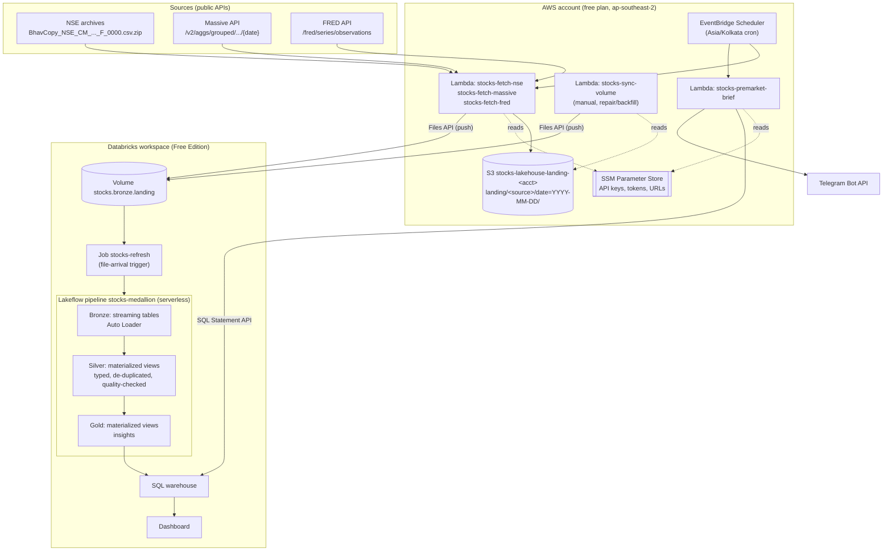

# Architecture

## Overview

## Components

| Component | What it does |
|---|---|
| **Fetcher Lambdas** | One per source. Download one day (or a date range) and write the raw file to S3, then push the same file to the Databricks volume. NSE zips are unzipped on the way into the volume. |
| **S3 landing bucket** | The permanent, untouched raw archive. Private, encrypted, versioned, HTTPS-only. |
| **Databricks volume** | The copy the pipeline reads. Same folder layout as S3. |
| **Lakeflow pipeline** | Bronze (Auto Loader streaming tables), silver and gold (materialized views). Written in Python, with the equivalent SQL in comments. |
| **Refresh job** | Runs the pipeline when new files land (waits 5 minutes after the last file, at most every 15 minutes). |
| **Dashboard** | AI/BI (Lakeview) dashboard on the gold tables, defined in Terraform. |
| **Pre-market Lambda** | Queries gold through the Databricks SQL Statement API and sends a Telegram message. |
| **Sync Lambda** | Copies anything in S3 that's missing from the volume. Used after backfills and to repair gaps. |
| **CI/CD** | GitHub Actions: checks on every push, plan on PR, apply on merge to `main`. |

## Why it's built this way

Most of the design comes from three constraints we hit while building it.

### 1. The AWS account is on the free plan ("projects" experience)

AWS-managed service control and resource control policies (which you can't edit) apply:

| Free-plan rule | Design decision |
|---|---|
| Only `us-east-1`, `us-west-2` and the project's region are allowed | Everything runs in **ap-southeast-2 (Sydney)**, the project region. Latency doesn't matter for a nightly batch. |
| IAM groups, login profiles and account aliases are denied | No IAM admin user. You sign in with **`aws login`** (browser, temporary credentials) through the built-in `AccountFullAccessRole`. |
| IAM identity providers (`iam:*Provider*`) are denied | **GitHub OIDC isn't possible.** CI uses two IAM users with access keys stored as GitHub secrets. |
| Outside AWS principals can't access project resources (RCP) | **Databricks never reads S3.** The Lambdas push files into a Databricks volume instead (outbound calls aren't blocked). |
| Only allow-listed services | Uses only S3, Lambda, EventBridge Scheduler, SSM, IAM roles, CloudWatch Logs. |

Upgrading the account and activating "advanced features" would remove these limits, but activation can't be
undone and removes the spend limit.

### 2. Databricks Free Edition

| Free Edition rule | Design decision |
|---|---|
| No account console or account-level APIs | Terraform uses only a workspace-level provider. No account groups or workspace assignment. |
| Catalogs use "Default Storage", which the API can't create | The `stocks` catalog is created once in the UI, then imported into Terraform (`prevent_destroy` protects it). |
| No custom S3 storage locations | Data lives in a **managed volume**; Lambdas push into it. |
| A service principal's Files API calls were rejected (403) even with entitlements | The Lambda uses a **dedicated, expiring personal token** created by Terraform and stored in SSM. The service-principal design is kept behind `pusher_identity = "service_principal"`. |
| Outbound internet is restricted | Telegram messages are sent from AWS Lambda, not from Databricks. |
| One active pipeline per type, limited job concurrency | One pipeline, one job. |

### 3. Source data quirks

| Quirk | Design decision |
|---|---|
| NSE files are `.csv.zip`; Spark reads gzip but not zip | S3 keeps the original zip; the Lambda pushes an **unzipped `.csv`** to the volume. |
| NSE changed to the UDiFF format on 8 Jul 2024 | History starts 8 Jul 2024; older files use different URLs and columns. |
| Massive bars contain fields `T` (ticker) and `t` (timestamp); Delta column names are case-insensitive | Bronze stores `results` as **raw JSON text**; silver renames `t` → `ts` before parsing. |
| Massive free plan keeps 2 years and is rate limited | Backfills wait 13 seconds per day; history starts ~2 years back. |
| FRED revises recent values; exchange rates are published weekly | Each FRED run fetches a **rolling 21-day window**; silver keeps the latest file's value. |
| A source folder may be empty (e.g. FRED before its key is set) | FRED bronze uses an **explicit schema**; Terraform puts a README in every source folder. |
| Stooq (planned global source) requires an API key since March 2026 and added a bot challenge in June 2026 | Replaced by **FRED** + US-listed country ETFs. |

## Security model

| Identity | Can | Cannot |
|---|---|---|
| You (`aws login` → `AccountFullAccessRole`) | Everything in the project | — |
| `stocks-fetch-nse-role` | `PutObject` to `landing/nse/*`, read Databricks push config | Read/list/delete S3, other prefixes |
| `stocks-fetch-us-role` | `PutObject` to `landing/massive/*`, read Massive key + push config | Same |
| `stocks-fetch-global-role` | `PutObject` to `landing/fred/*`, read FRED key + push config | Same |
| `stocks-sync-volume-role` | List/read `landing/*`, read push config | Write S3 |
| `stocks-premarket-role` | Read Databricks + Telegram settings from SSM | Any S3 access |
| `stocks-scheduler-role` | Invoke the fetcher and pre-market Lambdas | Anything else |
| `stocks-gha-plan` (CI) | Read-only (`ReadOnlyAccess`) | Any write |
| `stocks-gha-apply` (CI) | `PowerUserAccess` + IAM on `stocks-*` roles and `stocks-gha-*` users | Other IAM |

Secrets (Massive key, FRED key, Telegram token and chat ID) are created as **SSM placeholders** by Terraform and
set with the CLI, so they never appear in Terraform state or git. The Databricks pusher token is the exception:
Terraform creates it, so it's in the (private, encrypted) state.

## Repository conventions

- **Branches:** work on `dev`; `main` changes only through pull requests.
- **Line endings:** `.gitattributes` forces LF so Lambda zips and pipeline files hash the same on Windows and in CI.
- **Shared settings:** `infra/*/project.auto.tfvars` is committed, so local runs and CI apply the same values.
  Secrets never go there.
- **Formatting:** CI fails on `terraform fmt` differences. Run `terraform fmt -recursive infra` before pushing.
