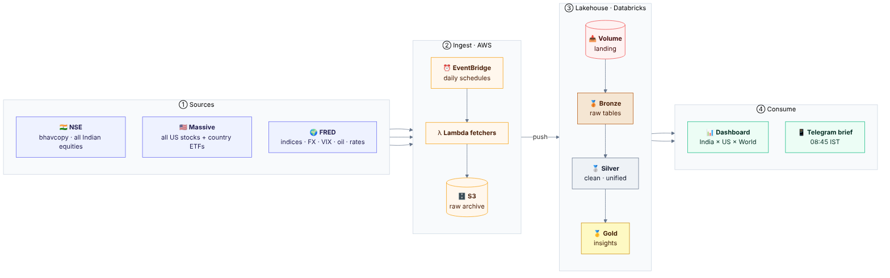
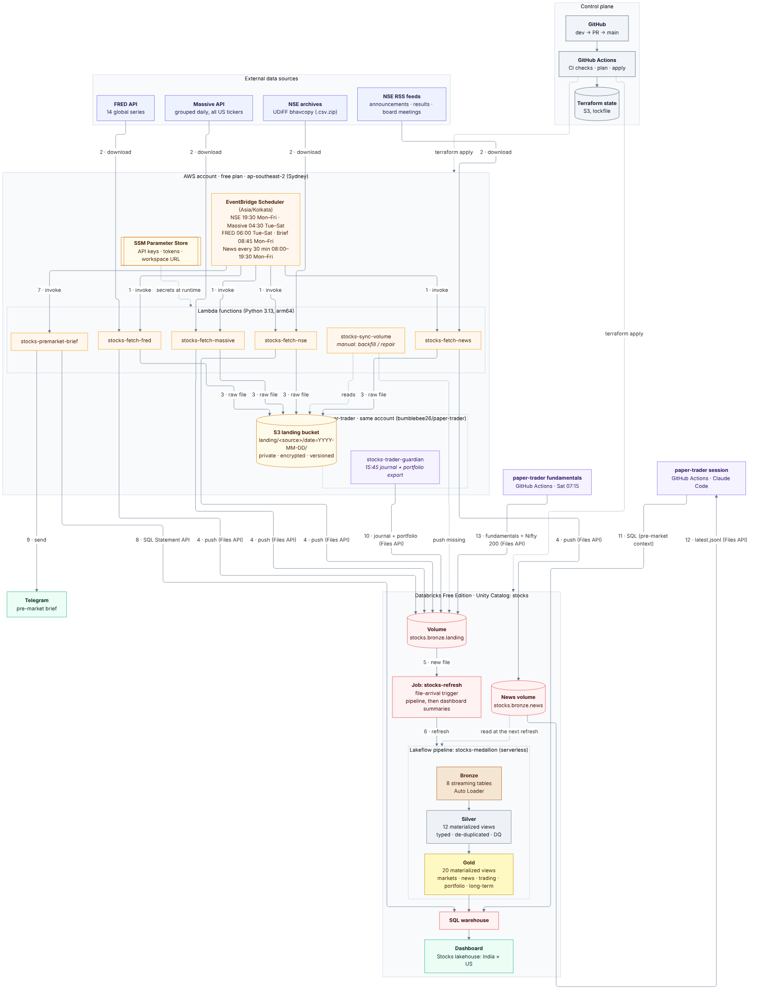
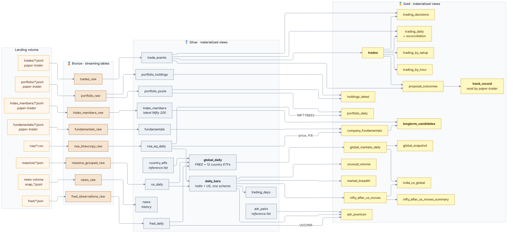
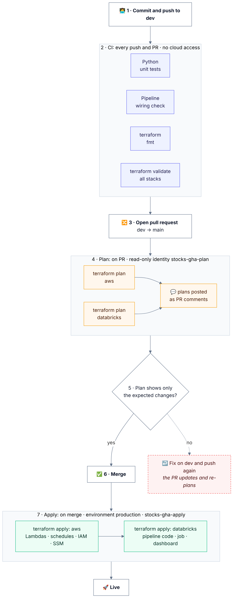
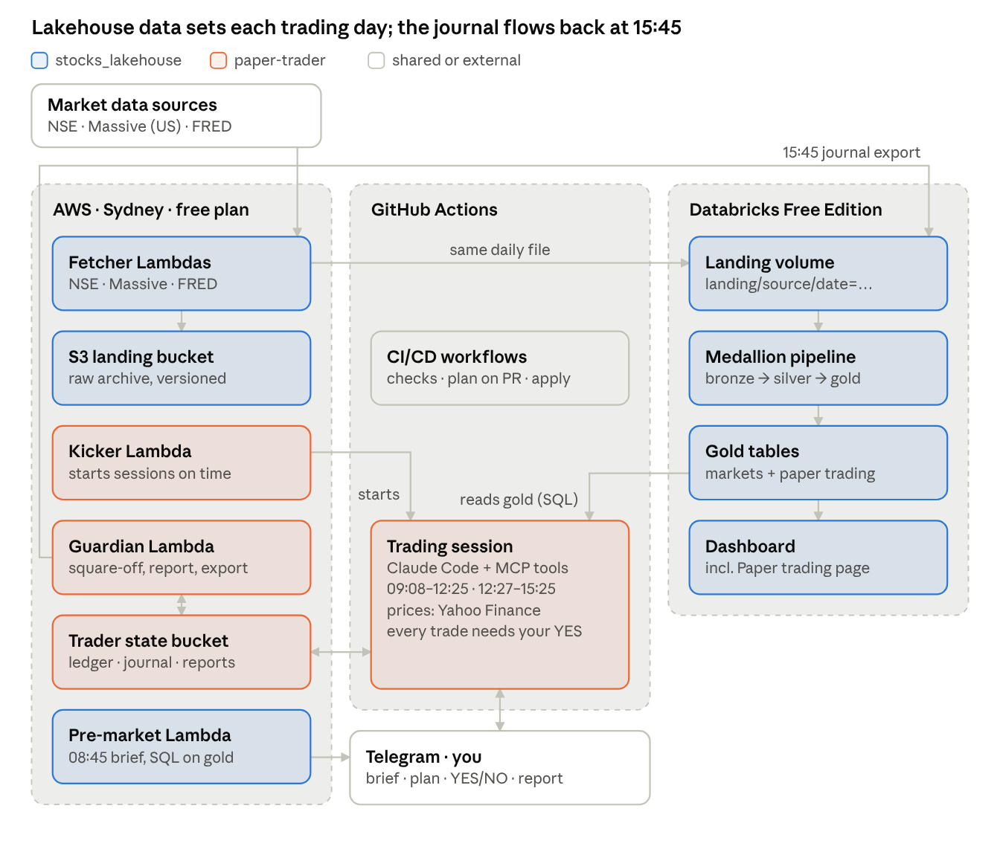
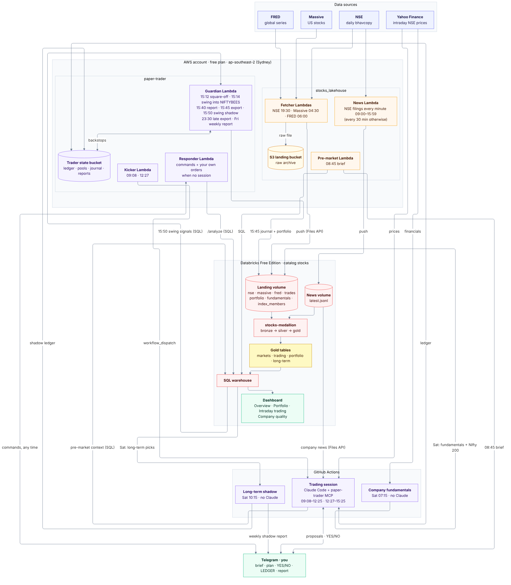

# Architecture diagrams

Five views of the stocks lakehouse, from the simplest to the most detailed, plus the platform it shares with
[paper-trader](https://github.com/bumblebee26/paper-trader). Each diagram is followed by an
explanation of what it shows and how to read it.

| # | Diagram | Answers |
|---|---|---|
| 1 | [Base diagram](#1-base-diagram) | What does the system do, end to end? |
| 2 | [Architecture](#2-architecture) | Which components exist, where do they run, and how does data move between them? |
| 3 | [Data lineage](#3-data-lineage) | Which table is built from which, from raw file to insight? |
| 4 | [CI/CD flow](#4-cicd-flow) | How does a change get from a commit into production? |
| 5 | [Platform with paper-trader](#5-platform-with-paper-trader) | How do the lakehouse and the paper trader fit together? |

The diagrams are written in Mermaid (`docs/diagrams/*.mmd`) and rendered to SVG and PNG. To change one, edit
its `.mmd` file and re-render (see [Updating the diagrams](#updating-the-diagrams)).

---

## 1. Base diagram



The whole system is four stages, read left to right:

| Stage | What happens | Runs on |
|---|---|---|
| **① Sources** | Three public data sources. **NSE** publishes one file per trading day with every Indian equity, and RSS feeds of company news (fetched every 30 minutes). **Massive** returns one file per US trading day with every US stock and ETF (including the country ETFs used for world markets). **FRED** provides 14 global series: equity indices, exchange rates, VIX, oil and US rates. | Third parties |
| **② Ingest** | **EventBridge** triggers a **Lambda fetcher** per source on a schedule (daily; news every minute in market hours, every 30 minutes otherwise). Each fetcher downloads the day's data, saves the untouched file in **S3** as a permanent raw archive, and **pushes** the same file into Databricks. | AWS |
| **③ Lakehouse** | Files land in a Unity Catalog **volume**. The medallion pipeline turns them into tables: **bronze** (raw, as delivered), **silver** (cleaned, typed, de-duplicated, India and US unified into one schema), **gold** (insights). | Databricks |
| **④ Consume** | A **dashboard** shows the gold tables. A **Telegram brief** at 08:45 IST, before the Indian market opens, summarises the US session, world markets, rates/FX/oil and India's setup. | Databricks, AWS, Telegram |

The key design choice is the **push** arrow between ② and ③: AWS sends files to Databricks, instead of
Databricks reading S3. The AWS free plan blocks outside accounts (including Databricks) from reading the
bucket, but outbound calls from Lambda are allowed.

---

## 2. Architecture



### Boxes

| Area | Components | Notes |
|---|---|---|
| **External data sources** | NSE archives, NSE RSS feeds, Massive API, FRED API | NSE needs browser-like headers; Massive and FRED need free API keys. |
| **AWS account** (free plan, `ap-southeast-2` Sydney) | EventBridge Scheduler, 6 Lambda functions, S3 landing bucket, SSM Parameter Store | The free plan only allows the project's region (plus `us-east-1` / `us-west-2`), so everything runs in Sydney. |
| **Databricks Free Edition** (Unity Catalog `stocks`) | Landing volume, news volume, refresh job, Lakeflow pipeline (bronze → silver → gold), SQL warehouse, dashboard | Serverless only. One pipeline, one job. |
| **Telegram** | Your chat with the bot | Receives the brief (and the paper trader's messages, same bot). |
| **paper-trader** (purple) | `stocks-trader-guardian` Lambda in the same account; the trading session and the weekly fundamentals job in GitHub Actions | Not managed by this repo. Shown where it touches the lakehouse: flows 10 to 13. |
| **Control plane** | GitHub, GitHub Actions, Terraform state in S3 | Deploys everything above. Not involved in the daily data flow. |

### Lambda functions

| Function | Trigger | Does |
|---|---|---|
| `stocks-fetch-nse` | 19:30 IST Mon–Fri | Today's NSE bhavcopy. Keeps the `.zip` in S3, pushes an unzipped `.csv` to the volume (Spark can't read zip). |
| `stocks-fetch-massive` | 04:30 and 07:30 IST Tue–Sat | The previous US session for all US tickers; each run also fetches any of the last 3 weekdays still missing. |
| `stocks-fetch-fred` | 06:00 IST Tue–Sat | The last 21 days for 14 series (late and revised values get corrected). |
| `stocks-fetch-news` | Every minute 09:00–15:59, every 30 min otherwise (08:00–19:30) IST Mon–Fri | NSE's announcement, results, board-meeting and corporate-action feeds to the **news volume**: `latest.jsonl` every run, `snap_HHMM.jsonl` (+ S3 copy under `landing/news/`) at :00/:30 and when new items appear. Kept out of the landing volume so it doesn't trigger a pipeline refresh. |
| `stocks-sync-volume` | Manual | Copies S3 files that are missing from the volume, after a backfill or a failed push. |
| `stocks-premarket-brief` | 08:45 IST Mon–Fri | Queries gold tables and sends the Telegram message. |

Long backfills **continue themselves**: when a fetcher nears Lambda's 15-minute limit it re-invokes itself
with the remaining dates, so one command can load years.

### The numbered flow (one trading day)

| Step | Arrow | What happens |
|---|---|---|
| **1** | Scheduler → fetchers | At the scheduled time (Asia/Kolkata cron), the scheduler invokes a fetcher. |
| **2** | Source → fetcher | The fetcher downloads that day's data. API keys come from SSM at runtime. |
| **3** | Fetcher → S3 | The raw file is written to `landing/<source>/date=YYYY-MM-DD/`. Each fetcher can only *add* files under its own prefix. |
| **4** | Fetcher → Volume | The same file is pushed to the Databricks volume with the Files API, using a dedicated token from SSM (news goes to its own volume, read at the next refresh). |
| **5** | Volume → Job | A new file triggers the `stocks-refresh` job (after 5 minutes without new files, at most every 15 minutes). |
| **6** | Job → Pipeline | The pipeline refreshes: Auto Loader reads only new files into bronze; silver and gold recompute. A second task then runs `sql/dashboard_summary.sql` for the dashboard's "In plain words" summaries. |
| **7** | Scheduler → brief | At 08:45 IST the brief Lambda starts. |
| **8** | Brief → SQL warehouse | It runs about 8 queries on gold tables through the SQL Statement API. If one fails, that section is skipped and the message says so. |
| **9** | Brief → Telegram | The formatted message (takeaways, tables) is sent through the Telegram Bot API. |
| **10** | Guardian → Volume | At 15:45 IST paper-trader's guardian Lambda pushes the day's trade journal to `landing/trades/date=YYYY-MM-DD/events.jsonl` and a portfolio snapshot to `landing/portfolio/date=YYYY-MM-DD/portfolio.jsonl` with the same Files API and pusher token. Steps 5–6 then build the trading and portfolio tables. |
| **11** | Session → SQL warehouse | Around 09:10 IST the trading session reads the same gold tables as the brief (US move, VIX, India's usual gap, unusual volume, ADRs) to set the day's risk and focus list. |
| **12** | News volume → session | For each proposal and `/news`, the trading session reads `latest.jsonl` (today and the last day) directly through the Files API; no SQL, no pipeline run. |
| **13** | Fundamentals job → Volume | Saturdays 07:15 IST paper-trader's *Company fundamentals* workflow pushes company financials to `landing/fundamentals/` and NSE's Nifty 200 list to `landing/index_members/`. |

Dotted arrows are not part of the daily run: **secrets at runtime** (SSM → Lambdas), the manual **sync**
path (S3 → sync → volume), and **terraform apply** from GitHub Actions into both clouds.

### Why it looks like this

| Constraint | Effect on the design |
|---|---|
| AWS free plan: outside principals can't read S3 | Push from Lambda instead of Databricks reading S3 |
| AWS free plan: no IAM identity providers | GitHub Actions uses two IAM users with access keys, not OIDC |
| Databricks Free Edition: no custom storage, no account APIs | Managed volume; workspace-level Terraform only; catalog created once in the UI |
| Databricks Free Edition: limited outbound internet | Telegram is called from AWS, not Databricks |
| Telegram has no table markup | The brief's tables are monospaced `<pre>` blocks, max 40 characters wide |

More detail: [ARCHITECTURE.md](ARCHITECTURE.md).

---

## 3. Data lineage



Read left to right. Every box is a table in the `stocks` catalog (except the landing files).

**Bronze**: one streaming table per source, fed by Auto Loader. Each file is read exactly once, and
columns are kept as delivered, plus lineage columns (`_source_file`, `_ingested_at`, `trade_date`).
- `nse_bhavcopy_raw`: NSE rows as strings.
- `massive_grouped_raw`: one row per US day, with `results` kept as JSON text (its `T`/`t` fields clash in
  case-insensitive Delta).
- `fred_observations_raw`: one row per series per date, with an explicit schema so it works even before the
  first file.
- `trades_raw`: one row per paper-trader journal event (dummy money), explicit schema.
- `portfolio_raw`, `fundamentals_raw`, `index_members_raw`: paper-trader's daily portfolio snapshot, weekly
  company financials and the Nifty 200 list, explicit schemas.
- `news_raw`: one row per news item per 30-minute snapshot, read from the news volume.

**Silver**: cleaned and unified.
- `nse_eq_daily` and `us_daily` type the data, drop bad rows (data-quality expectations: positive prices,
  high ≥ low), and keep the newest copy when a day was fetched twice.
- **`daily_bars`** puts India and the US in one schema (`market`, `symbol`, `trade_date`, OHLC, volume,
  currency). Most gold tables read only this.
- `trading_days` is each market's calendar, derived from the data.
- `fred_daily` de-duplicates FRED; **`global_daily`** combines it with 12 US-listed country ETFs from
  `us_daily` (listed in `country_etfs`) into one long table of world instruments.
- `country_etfs` and `adr_pairs` are small reference lists kept as tables, so the views that join them can
  refresh incrementally.
- `trade_events` types the paper-trader events and keeps the newest copy of each `event_id`.
- `portfolio_pools` and `portfolio_holdings` split the newest portfolio file of each day into pools and holdings.
- `fundamentals` keeps the newest fetch of each company × metric × period; `index_members` is the latest
  Nifty 200 list.
- `news` keeps the earliest snapshot of each item and sorts it into categories (results, board meeting, rating...):
  the history of company news (the trader reads today's news straight from the news volume).

**Gold**: the insights.

| Table | Built from | Answers |
|---|---|---|
| `market_breadth` | daily_bars | How broad was each market's move? |
| `unusual_volume` | daily_bars | Which stocks traded ≥ 3× their 20-day average volume? |
| `nifty_after_us_moves` → `_summary` | daily_bars | What does India do after big US up / down / flat days? |
| `adr_premium` | daily_bars + adr_pairs + fred_daily (USD/INR) | Are Indian ADRs rich or cheap versus their NSE shares? |
| `global_markets_daily` → `global_snapshot` | global_daily | How did each world market move (1/5/20 days), and what's the latest? |
| `india_vs_global` | global_markets_daily + nifty_after_us_moves | Which world markets' moves line up with India's next open? |
| **`trades`** | trade_events | Each paper trade from entry to exit: net P&L, R multiple |
| `trading_daily` | trades + trade_events | Each day's activity and P&L, reconciled against the trader's ledger |
| `trading_by_setup`, `trading_by_hour` | trades | Which setups and hours make money? |
| `trading_decisions` | trades + trade_events | Did the YES/NO choices help? |
| `proposal_outcomes` → `track_record` | trade_events + trades | How did every proposal turn out (taken or skipped), by setup, hour, mood, suggestion band, reviewer, mode and your 👍/👎? paper-trader reads `track_record` every session: the feedback loop. |
| `portfolio_daily` | portfolio_pools + nse_eq_daily (NIFTYBEES) | How are all dummy pools doing, against just holding NIFTYBEES? |
| `holdings_latest` | portfolio_holdings + portfolio_pools | What's held now, and what weight does each holding have? |
| `company_fundamentals` | fundamentals + nse_eq_daily | Which large companies pass the long-term quality tests? |
| **`longterm_candidates`** | company_fundamentals + index_members | What would the long-term pool buy this week, and why? |

Two more gold tables are not in the pipeline: `dashboard_summary_facts` and `dashboard_summary`, rebuilt by
`sql/dashboard_summary.sql` after each refresh for the dashboard's "In plain words" boxes.

Column-level detail: [DATA_MODEL.md](DATA_MODEL.md).

---

## 4. CI/CD flow



Every change, whether code, pipeline, dashboard or settings, follows the same path:

| Step | What happens | Identity |
|---|---|---|
| **1. Commit to `dev`** | All work happens on `dev`. | You |
| **2. CI** | On every push and PR: Python unit tests, pipeline wiring check (every table defined, every dependency resolves), `terraform fmt`, `terraform validate` on all stacks. No cloud access needed. | GitHub Actions |
| **3. Pull request** | Open a PR from `dev` into `main`. `main` is protected and only changes this way. | You |
| **4. Plan** | `terraform plan` runs for the `aws` and `databricks` stacks against the real state, and each plan is posted as a PR comment. The databricks job also checks every dashboard query and `sql/` statement against the SQL warehouse with `EXPLAIN` (`scripts/check_sql.py`; nothing is executed). | `stocks-gha-plan` (read-only) |
| **5. Review** | Check that the plan shows only the changes you expect. If not, fix on `dev` and push; the PR re-plans automatically. | You |
| **6. Merge** | Merging starts the apply. | You |
| **7. Apply** | `terraform apply` for `aws` (Lambdas, schedules, IAM, SSM), then `databricks` (pipeline code, job, dashboard). Runs in the `production` environment. | `stocks-gha-apply` |

Only one Terraform run uses the shared state at a time (a single concurrency group, plus S3 state locking).
Secrets never pass through this flow: API keys and Telegram details are set in SSM with the CLI, and
Terraform only creates placeholders.

More detail: [OPERATIONS.md](OPERATIONS.md#making-a-change).

---

## 5. Platform with paper-trader

**At a glance** (blue = this repo, orange = paper-trader):



**In detail:**



The lakehouse and [paper-trader](https://github.com/bumblebee26/paper-trader) share one AWS account (free
plan, Sydney), one Databricks workspace, one Telegram bot and the same CI/CD pattern. They meet at these points:

| When (IST) | Direction | What |
|---|---|---|
| ~09:10 | lakehouse → trader | The trading session reads gold tables over SQL to set the day's risk (from VIX), bias (India's usual gap after similar US days) and focus list (unusual volume, ADR moves). |
| During sessions | lakehouse → trader | The session reads the news volume's `latest.jsonl` for each proposal and `/news`. |
| 15:45 | trader → lakehouse | The guardian Lambda pushes the day's journal to `landing/trades/` and a portfolio snapshot to `landing/portfolio/`; the pipeline builds the `trad*` and portfolio gold tables and the dashboard's Intraday trading and Portfolio pages. |
| Sat 07:15 | trader → lakehouse | The *Company fundamentals* workflow pushes financials to `landing/fundamentals/` and the Nifty 200 list to `landing/index_members/`; the pipeline builds `company_fundamentals` and `longterm_candidates` (Company quality page). |

Shared resources: the Terraform state bucket (trader key `paper-trader/aws/…`), the CI users
`stocks-gha-plan` / `stocks-gha-apply` (trader resources are named `stocks-trader-*` so the apply user may
manage them), and the `/stocks/telegram-*` and `/stocks/databricks-*` parameters. Secrets and deployments are
left out of this picture; see [ARCHITECTURE.md](ARCHITECTURE.md#security-model) and [diagram 4](#4-cicd-flow).

The same `.mmd` file is in paper-trader as `docs/diagrams/01_platform.mmd`; change both together.
The written overview of the whole platform is [PLATFORM.md](PLATFORM.md).

---

## Updating the diagrams

The sources are in `docs/diagrams/`:

| File | Diagram |
|---|---|
| `01_overview.mmd` | Base diagram |
| `02_architecture.mmd` | Architecture (ELK layout) |
| `03_lineage.mmd` | Data lineage (ELK layout) |
| `04_cicd.mmd` | CI/CD flow |
| `05_platform.mmd` | Platform with paper-trader (ELK layout; identical copy in paper-trader) |
| `platform_overview.png` | Platform at a glance. Not Mermaid: exported from the shared "Stocks Platform Architecture" doc; same image in paper-trader |
| `theme.json` | Shared fonts and colours |

Edit the `.mmd` file, then re-render SVG and PNG with the Mermaid CLI
(`npm install -g @mermaid-js/mermaid-cli`):

```
scripts\render_diagrams.cmd        (Windows)
scripts/render_diagrams.sh         (macOS / Linux)
```

Commit both the `.mmd` source and the rendered files. The pages embed the PNGs, which display in every
viewer. The SVGs are there for zooming without blur; open them directly in a browser.

Colour key used throughout: **blue**: external sources and CI checks; **orange**: AWS; **red**: Databricks;
**bronze / silver / gold**: medallion layers; **green**: outputs and deployments; **grey**: control plane; **purple**: paper-trader.
