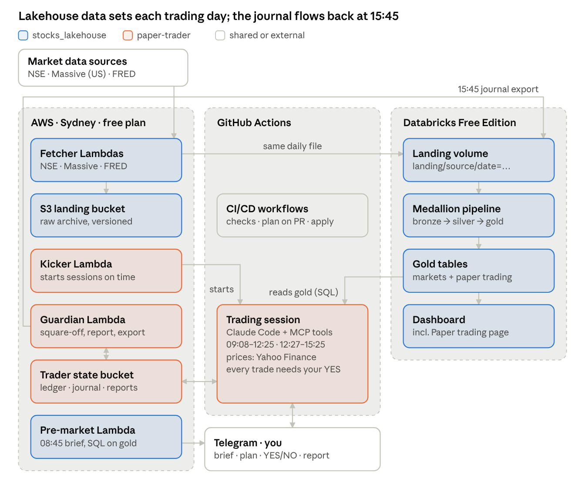
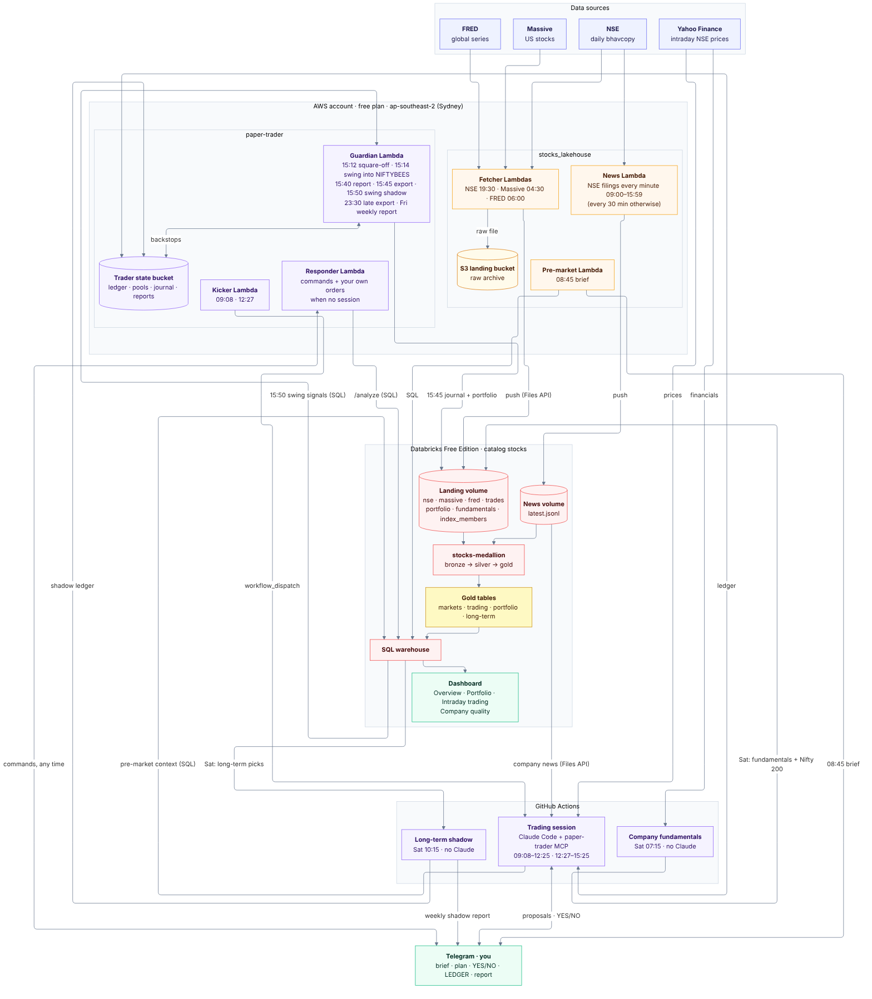

# Stocks platform: stocks_lakehouse + paper-trader

> The shared overview of both repositories. The same file is in
> [stocks_lakehouse](https://github.com/bumblebee26/stocks_lakehouse/blob/main/docs/PLATFORM.md) and
> [paper-trader](https://github.com/bumblebee26/paper-trader/blob/main/docs/PLATFORM.md); change both together
> (only the diagram path differs). As of 9 Nov 2026.

## Overview

Two repositories form one platform: **stocks_lakehouse** collects and analyses India and US market data, and
**paper-trader** uses that analysis to run a mock intraday trader with dummy money (an Rs 40,000 intraday pool of an Rs 2,00,000 dummy portfolio), with every
trade approved by you on Telegram.

- **stocks_lakehouse** fetches NSE, US (Massive), global (FRED) and NSE company news into S3 and Databricks,
  builds bronze → silver → gold tables, sends the 08:45 pre-market brief and serves the dashboard.
- **paper-trader** reads the same gold tables before the open to set the day's risk and focus list, runs two
  Claude Code sessions in GitHub Actions, and sends its journal and a portfolio snapshot back to the lakehouse
  at 15:45 for analysis and as a backup record. On Saturdays it also sends company financials for the Nifty 200,
  which the lakehouse scores for the long-term pool.
- Both run on one AWS account (free plan, Sydney), one Databricks Free Edition workspace, one Telegram bot,
  and the same GitHub CI/CD pattern.

## System diagram

**At a glance** (blue = stocks_lakehouse, orange = paper-trader):

No servers anywhere: scheduled Lambdas in AWS, a GitHub Actions job for the trading session, and a Databricks
pipeline. The systems meet at fixed points: the session reads the gold tables before the open and the news
file during the day, the guardian exports the journal and portfolio snapshot to the landing volume at 15:45,
and the Saturday fundamentals job pushes company financials.

**In detail** (purple = paper-trader; source `docs/diagrams/05_platform.mmd`, identical in both repos):

Secrets (SSM) and deployments (CI/CD) are left out of both pictures; they're covered below.

## A day in the life

On a trading day the lakehouse feeds the trader in the morning and the trader feeds the lakehouse in the
afternoon. All times IST; every step is scheduled, nothing needs you except the YES/NO taps.

| Time (IST) | Days | System | What happens |
|---|---|---|---|
| 04:30 | Tue–Sat | Lakehouse | Massive: previous US session, all US stocks (07:30 retry catches up any missed day) |
| 06:00 | Tue–Sat | Lakehouse | FRED: indices, FX, VIX, oil, rates (21-day window) |
| every 30 min, 08:00–19:30 | Mon–Fri | Lakehouse | NSE company news to the news volume (`latest.jsonl`, read by the trader) |
| 08:45 | Mon–Fri | Lakehouse | Pre-market brief to Telegram |
| 09:08 | Mon–Fri | Trader | Kicker Lambda starts the morning session; plan + focus list to Telegram |
| 09:16 | Mon–Fri | Trader | GitHub cron backup start (skips if already running) |
| 09:20–12:25 | Mon–Fri | Trader | Every 5 min: check positions, scan focus list, propose; you tap YES/NO |
| 12:27 | Mon–Fri | Trader | Afternoon session; new entries stop at 14:30 |
| 15:10 | Mon–Fri | Trader | Square-off, then day report to Telegram |
| 15:12 / 15:40 | Mon–Fri | Trader | Guardian backstops: square-off and report if the session didn't |
| 15:14 | Mon–Fri | Trader | Guardian puts the swing pool's idle cash into NIFTYBEES |
| 15:45 | Mon–Fri | Trader → Lakehouse | Journal export to `landing/trades/` and portfolio snapshot to `landing/portfolio/`; pipeline builds the trading and portfolio tables |
| 17:55 | Fri | Trader | Weekly report to Telegram |
| 19:30 | Mon–Fri | Lakehouse | NSE bhavcopy for the day; pipeline refresh, then the dashboard's plain-words summaries |
| 23:30 | Mon–Fri | Trader → Lakehouse | Late export: the last 4 days' journals again, so evening 👍/👎 ratings reach the track record overnight |
| 07:15 | Sat | Trader → Lakehouse | Company fundamentals job: Nifty 200 financials to `landing/fundamentals/`, the list to `landing/index_members/` |
| 10:15 | Sat | Lakehouse → Trader | Long-term shadow job: reads this week's picks, "buys"/sells in the shadow ledger, report to Telegram |
| every 2 min | all week | Trader | Responder answers Telegram commands when no session is live |

## Components

Every running part is either a scheduled Lambda in AWS Sydney, a Databricks object, or a GitHub Actions job;
there are no servers.

| Component | Repo | Runs on | What it does |
|---|---|---|---|
| Fetcher Lambdas (NSE, Massive, FRED) | lakehouse | AWS Lambda | Download a day of data, archive it in S3, push the same file to the Databricks volume |
| News Lambda | lakehouse | AWS Lambda | Every 30 min: NSE announcements, results, board meetings and corporate actions to the news volume (`/Volumes/stocks/bronze/news/`), kept out of the landing volume so it doesn't trigger a refresh |
| S3 landing bucket | lakehouse | AWS S3 | Permanent, untouched raw archive (private, encrypted, versioned) |
| Sync Lambda | lakehouse | AWS Lambda | Copies anything missing from S3 to the volume (backfills, repairs) |
| Landing volume | lakehouse | Databricks | `/Volumes/stocks/bronze/landing/<source>/date=…/`, what the pipeline reads |
| `stocks-medallion` pipeline | lakehouse | Databricks | Bronze streaming tables, silver and gold materialized views |
| `stocks-refresh` job | lakehouse | Databricks | Runs the pipeline when files land (waits 5 min, at most every 15 min), then `sql/dashboard_summary.sql` (plain-words page summaries, `ai_summarize`) |
| Dashboard | lakehouse | Databricks | Pages Overview, Portfolio, Intraday trading, Company quality and Details, each with an "In plain words" summary |
| Pre-market Lambda | lakehouse | AWS Lambda | 08:45 brief: queries gold, sends Telegram |
| Trading session | paper-trader | GitHub Actions | Claude Code + paper-trader MCP tools; morning and afternoon runs |
| Trader engine and MCP tools | paper-trader | inside the session | Ledger, risk gate, Telegram approvals, simulated fills, exits, report |
| Trader state bucket | paper-trader | AWS S3 | Ledger, journal, plans, reports, exports |
| Kicker Lambda | paper-trader | AWS Lambda | Starts each session on time via the GitHub API |
| Guardian Lambda | paper-trader | AWS Lambda | No Claude: 15:12 square-off, 15:14 swing pool into NIFTYBEES, 15:40 report, 15:45 journal + portfolio export to the lakehouse, Fri 17:55 weekly report |
| Responder Lambda | paper-trader | AWS Lambda | Answers every Telegram command outside sessions within ~2 min |
| Company fundamentals job | paper-trader | GitHub Actions | Saturdays 07:15, no Claude: Nifty 200 list + Yahoo financials to the landing volume |
| Long-term shadow job | paper-trader | GitHub Actions | Saturdays 10:15, no Claude: acts on `longterm_candidates` in a shadow ledger (nothing real bought), report to Telegram |
| Backtests (swing, long-term) | paper-trader | GitHub Actions | Manual, no Claude: test pool rules on the lakehouse's NSE prices and company figures, summary to Telegram |

## Data flows and contracts

The two systems touch in a few places, each with a fixed contract: the trader reads named gold tables in the
morning and the news file during the day, writes two JSON-lines files per day in the afternoon (journal and
portfolio), and two per week on Saturdays (fundamentals and the Nifty 200 list).

| Flow | From → to | Contract | When |
|---|---|---|---|
| Market data in | NSE, Massive, FRED → S3 + volume | One file per source per day under `<source>/date=YYYY-MM-DD/` | 04:30 (+07:30 retry), 06:00, 19:30 |
| Pre-market context | gold tables → trader (`premarket_context`) | Read-only SQL on `nifty_after_us_moves_summary`, `global_snapshot`, `unusual_volume`, `silver.daily_bars` | ~09:10 |
| Company news | news volume `date=YYYY-MM-DD/latest.jsonl` → trader | Read through the Files API (today and the last day), cached 10 min; failure = "news unavailable" | every proposal, `/news` |
| Approvals | Trader ↔ Telegram | Proposal with YES/NO buttons; no reply in 3 min = skipped; `EXIT SYMBOL` closes | 09:20–14:30 |
| Commands | You → Telegram → session or responder | `/help` (also "what can you do?"), `/ledger`, `/plan`, `/exit`, `/news`, `/portfolio`, `/pause`, `/stop`, `/resume`. Telegram allows one reader: the session answers while live, the responder otherwise | any time |
| Ledger | Trader ↔ S3 `state/ledger.json` | Read, change, write back on every tool call; versioned 30 days | all session |
| Journal export | Trader → `landing/trades/date=YYYY-MM-DD/events.jsonl` | One line per event with unique `event_id` + `proposal_id`; last line `ledger_snapshot` | 15:45 |
| Portfolio snapshot | Trader → `landing/portfolio/date=YYYY-MM-DD/portfolio.jsonl` | One `pool` row per pool (capital, cash, holdings value, equity) and one `holding` row per holding; newest file per day wins | 15:45 |
| Long-term picks | `gold.longterm_candidates` → shadow job | Read-only SQL: rank, `is_pick`, `target_weight_pct`, `reasons`, last close | Sat 10:15 |
| Fundamentals | Trader job → `landing/fundamentals/date=YYYY-MM-DD/fundamentals.jsonl`, `landing/index_members/date=YYYY-MM-DD/nifty200.jsonl` | One line per company × metric × period; one line per Nifty 200 company (symbol, company, industry, ISIN) | Sat 07:15 |
| Trading analysis | `trades_raw` → `trade_events` → `gold.trad*` | Newest copy per `event_id`; net P&L = exit `pnl_rs` − entry `fees_rs` | after 15:45 |

**Reconciliation.** `gold.trading_daily` rebuilds each day's realized P&L from the events and compares it with
the ledger's own `realized_today` from the snapshot line: `ok` within Rs 1, `MISMATCH` otherwise. Two
independent records that must agree is the platform's main integrity check on the dummy money.

**Money on Telegram.** Every proposal shows the margin it needs against what's free; every fill and exit ends
with `Ledger: balance … | in use … | free … | today …`. In use = position value ÷ 5 (simulated intraday
margin), free = balance − in use.

**Gold tables for trading:** `trades` (each trade, R multiple), `trading_daily`, `trading_by_setup`,
`trading_by_hour`, `trading_decisions` (what skipped proposals would have made). **For the portfolio:**
`portfolio_daily` (value of all pools vs NIFTYBEES), `holdings_latest`. **For the long-term pool:**
`company_fundamentals` (quality tests), `longterm_candidates` (this week's picks and weights; shadow mode, nothing
is bought yet).

## Status and roadmap

Where each phase of the system plan stands. The full plan (pools, rules, backtests, risks, decisions) is
[SYSTEM_PLAN.md](SYSTEM_PLAN.md), in both repos; this table is the short version.

| Phase | Status | Live parts | Next |
|---|---|---|---|
| 1 Intraday upgrades | Live from 10 Nov | 10 trades a day, 4R daily loss limit incl. open risk, weekly brake, cost filter, cool-off after 3 losses, exit rules on trial, auto mode (places a trade only if the suggestion is over 55%, raised for losing groups and flips, the trading agent over 50% and the reviewer answered; 6 trades a day; off at the weekly brake) with 👍/👎 ratings by button or reaction for 7 days and a lakehouse track record read every session, 36 stocks in 11 sectors, sector and position caps | Track-record review 23 Nov |
| 2 Foundations | Live | Company news on proposals, market mood, shadow rule variants, `/news` `/portfolio` `/stop`, data alerts, pool ledgers, circuit breaker, weekly report | One-tap reasons, idle-cash interest (later) |
| 3 Swing pool | On hold | Rs 60,000 held in NIFTYBEES (from 10 Nov 15:14) | Retry with results-based setups once news history exists |
| 4 Long-term pool | Shadow mode | Weekly figures for the Nifty 200, quality tests, 10 picks a week, backtest, Saturday shadow report | Go/no-go 18 Dec, live buying from 21 Dec |
| 5 Track record | Collecting data | Suggestion %, agent and reviewer scores and shadow-rule blocks recorded on every proposal | Review 23 Nov |

| Backtest | Period | Result | NIFTYBEES |
|---|---|---|---|
| Swing, original rules | 15 May 2025 – 6 Nov 2026 | -4% to -21% (four versions) | +3.0% |
| Swing, tuned then tested on unseen months | May – Nov 2026 | -3.8% (5 trades) | +4.1% |
| Long-term, picked from today's Nifty 200 (hindsight) | 1 Jul 2025 – 9 Nov 2026 | +19.7% (re-picked yearly: +25.5%) | +0.3% |
| Long-term, picked from the most traded stocks of Apr–Jun 2025 (no hindsight) | 1 Jul 2025 – 9 Nov 2026 | +1.9% (re-picked yearly: +8.4%), deepest fall ~9% vs ~14% | +0.3% |

The honest long-term edge is the no-hindsight row: modest, with smaller falls. The shadow weeks decide.

Reviews on the calendar: cost review Sun 15 Nov, track record Mon 23 Nov, long-term go/no-go Fri 18 Dec.

## Platform constraints and design decisions

The design follows from three free tiers; each row is a limit we hit or planned around, and what the platform
does about it.

| Limit | Where | Decision |
|---|---|---|
| Only S3, Lambda, EventBridge Scheduler, SSM, IAM roles, CloudWatch Logs | AWS free plan | No servers: every job is a scheduled Lambda; the first EC2 design was denied and rebuilt |
| Only Sydney, us-east-1, us-west-2 | AWS free plan | Everything in ap-southeast-2 (Sydney) |
| No IAM identity providers (no GitHub OIDC) | AWS free plan | CI uses IAM users with access keys stored in GitHub environments |
| Lambda runs at most 15 min | AWS Lambda | The 3-hour Claude Code sessions run in GitHub Actions instead |
| A job lasts at most 6 h; cron can start late or not at all | GitHub Actions | Morning + afternoon sessions; kicker Lambda starts them on time, cron as backup |
| Branch rules only on public repos (free plan) | GitHub | Both repos public; no secrets in code |
| Serverless compute quota | Databricks Free Edition | Files land a few times a day; the trader exports once at 15:45, not per trade |
| Usage limits shared with your chats | Claude Pro/Max | One `run_cycle` + one wait per 5 min; guardian squares off if a session stops |
| Prices unofficial, may lag minutes | Yahoo Finance | Accepted for mock trading; tested from GitHub runners |

## Security, identities and secrets

Each identity can do one job; no secret lives in code, and the only person with full access is you through
`aws login`.

| Identity | Used by | Can |
|---|---|---|
| You (`AccountFullAccessRole` via `aws login`) | Local Terraform, setup | Everything in the project |
| `stocks-gha-plan` | Both repos: plan on PR | Read-only (no state lock) |
| `stocks-gha-apply` | Both repos: apply on merge | Manage project services; IAM only for `stocks-*` roles and `stocks-gha-*` users |
| `stocks-gha-trader` | Trading session, fundamentals, shadow and backtest jobs | Read/write the trader state bucket (no delete); read Telegram + Databricks parameters |
| Lakehouse Lambda roles | Fetchers (incl. news), sync, pre-market | Their own bucket, parameters and the pusher token |
| `stocks-trader-guardian-role` | Guardian and responder Lambdas | Trader state bucket; Telegram + Databricks push parameters |
| `stocks-trader-kicker-role` | Kicker Lambda | Read the GitHub dispatch token only |
| Claude in a session | Trading session | Only the paper-trader MCP tools; no shell, files or web |

| Secret | Lives in | Expires | Rotate |
|---|---|---|---|
| Telegram bot token, chat ID | SSM `/stocks/telegram-*` | Never | BotFather if leaked |
| Databricks pusher token | SSM `/stocks/databricks-pusher-token` | 180 days | Lakehouse runbook |
| Massive API key | SSM `/stocks/*` | Never | Massive dashboard if leaked |
| GitHub dispatch token | SSM `/stocks-trader/github-dispatch-token` | 1 year | New fine-grained token with **Actions: Read and write** on paper-trader, then `put-parameter` |
| Claude token | GitHub env `trading` | 1 year | `claude setup-token` |
| CI and session AWS keys | GitHub secrets / environments | Never | Yearly, two keys per user allowed |

Trades still need your YES: the engine refuses to execute anything not approved, whatever Claude asks.

## CI/CD and branch rules

Both repos ship the same way: work on `dev`, open a pull request to `main`, read the Terraform plan in the PR
comment, merge to apply.

1. Push to `dev` → CI: Python tests, `terraform fmt`, `terraform validate` per stack.
2. Pull request `dev` → `main` → `terraform plan` with the read-only identity, posted as a PR comment (the
   lakehouse also checks every dashboard and summary query against the SQL warehouse with `EXPLAIN`).
3. Merge → `terraform apply` in the `production` environment; the next scheduled run uses the new code.

| | stocks_lakehouse | paper-trader |
|---|---|---|
| Stacks | `aws`, `databricks` (+ `bootstrap` once) | `aws` |
| State | S3 bucket `stocks-lakehouse-tfstate-<account>` | Same bucket, key `paper-trader/aws/` |
| Required checks on `main` | `terraform fmt`, `terraform validate (aws)`, `terraform validate (databricks)` | `Python tests and MCP server`, `terraform fmt`, `terraform validate (aws)` |
| Ruleset `protect-main` | PR required, no force push, no deletion | same |
| Extra workflows | — | `trading-session.yml`, `fundamentals.yml` and `longterm-shadow.yml` (Saturdays), `swing-backtest.yml` and `longterm-backtest.yml` (manual); environment `trading` |

Shared conventions: LF line endings (`.gitattributes`), committed `project.auto.tfvars` for non-secret
settings, committed `.terraform.lock.hcl`, docs in `docs/` (ARCHITECTURE, SETUP, OPERATIONS, TROUBLESHOOTING,
PLATFORM), Mermaid diagrams in `docs/diagrams/` with one shared theme.

## Operations, costs and where to find things

The platform is meant to run at no extra cost beyond your Claude plan; the first cost review is on
Sunday 15 Nov 2026, after a full trading week.

| Cost item | Expected | Watch |
|---|---|---|
| AWS (Lambda, S3, Scheduler, SSM) | Near zero, inside free-plan credits | AWS Settings → project credits |
| Databricks | Free Edition quota (pipeline, SQL warehouse, `ai_summarize` after each refresh) | Pipeline runs per day |
| GitHub Actions | Free (public repos) | Session run time, ~6 h per trading day |
| Claude | Your Pro/Max plan | Sessions ending early on usage limits |
| Data (Massive, FRED, NSE, Yahoo) | Free tiers | Fetch failures in Lambda logs |

| Need | Go to |
|---|---|
| Lakehouse design, tables, setup, runbook | [stocks_lakehouse docs](https://github.com/bumblebee26/stocks_lakehouse/tree/main/docs) |
| Trader design, setup, runbook | [paper-trader docs](https://github.com/bumblebee26/paper-trader/tree/main/docs) |
| Live money (balance, in use, free, open positions) | Send `LEDGER` on Telegram during a session, or S3 `stocks-trader-state-538498973473/state/ledger.json` |
| Session logs | paper-trader → Actions → Trading session |
| Journal, reports | S3 `stocks-trader-state-538498973473` (`journal/`, `reports/`) |
| Trading results | Databricks dashboard → Intraday trading page (after 15:45) |
| All pools and holdings | Send `/portfolio` on Telegram, or Databricks dashboard → Portfolio page (after 15:45) |
| Long-term picks | Databricks dashboard → Company quality page (after the Saturday fundamentals run); Saturday shadow report on Telegram |
| Backtest results | S3 `stocks-trader-state-538498973473/backtests/` (`swing/`, `longterm/`) |
| Kicker problems | `aws logs tail /aws/lambda/stocks-trader-kicker --since 3h --region ap-southeast-2` |
| Pause trading | Disable the Trading session workflow; set `dispatch_enabled = false` via PR |
